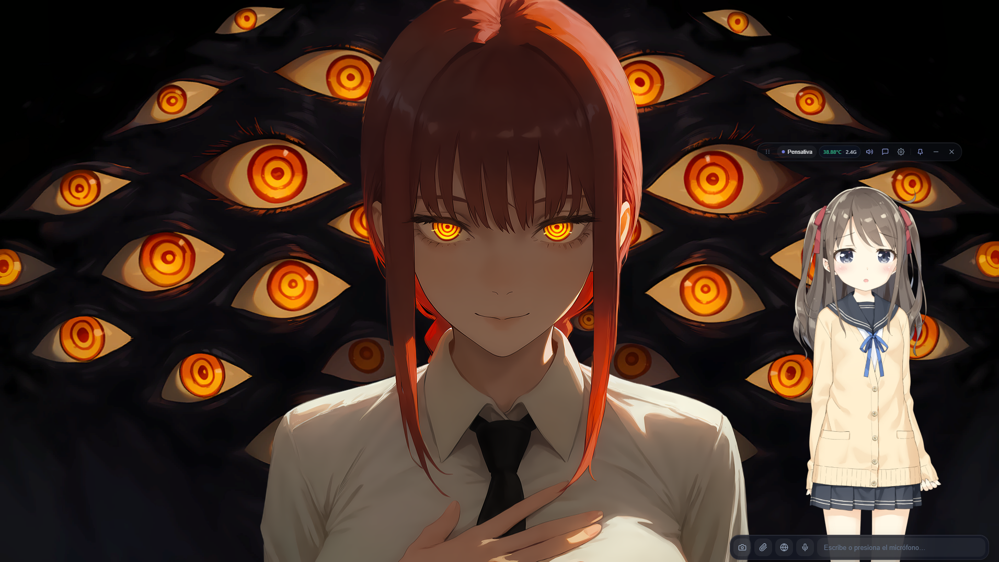
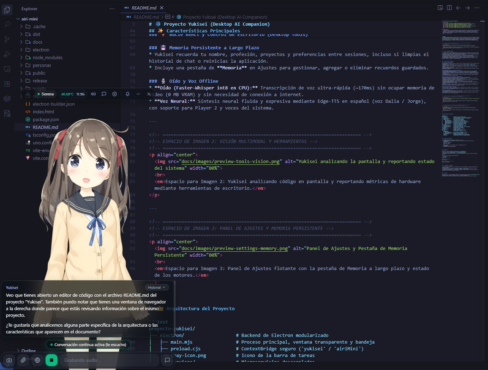
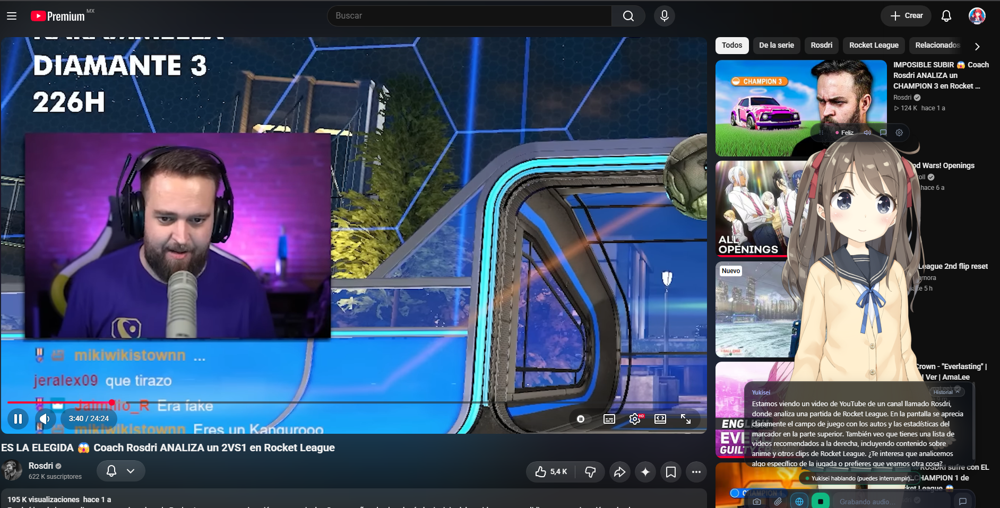
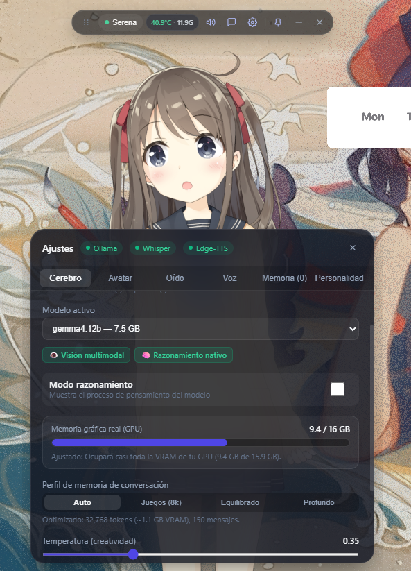

# ❄️ Yukisei — Desktop AI Companion

<p align="center">
  
  
  
  
  
  
  
</p>

<p align="center">
  <b>Yukisei</b> es una compañera y asistente virtual de escritorio interactiva, autónoma y 100% privada para Windows. Cuenta con un avatar <b>Live2D interactivo</b>, inteligencia local mediante <b>Ollama</b>, reconocimiento de voz adaptado al español, síntesis de voz neural, visión de pantalla en tiempo real, memoria persistente a largo plazo y control del sistema operativo mediante herramientas de escritorio seguras.
</p>

---

<p align="center">
  
  <br>
  <em>Yukisei acompañándote en el escritorio: Avatar Live2D interactivo sobre fondo transparente, cápsula superior de telemetría y dock de conversación fluido.</em>
</p>

---

## 📌 Estado del Proyecto & Compatibilidad de Hardware

> [!IMPORTANT]
> ### 🚀 Primera Versión (v1.0.0 Release Preview)
> Esta es la **primera versión funcional** de Yukisei. Es un proyecto de desarrollo personal y se encuentra en evolución continua; seguiré mejorándolo, puliendo detalles y optimizando su rendimiento a futuro.

> [!WARNING]
> ### ⚠️ Entorno de Prueba Exclusivo (Hardware)
> Esta versión fue desarrollada y testeada **EXCLUSIVAMENTE en una GPU NVIDIA GeForce RTX 5070 Ti con 16 GB de VRAM**.
> * **No se han testeado otras tarjetas gráficas (AMD, Intel u otras gamas NVIDIA).**
> * **No se han testeado otros modelos de IA locales ni cuantizaciones diferentes a las probadas.**
> * No garantizo cómo vaya a rendir o funcionar en configuraciones con menor VRAM o hardware distinto. Si cuentas con un equipo diferente, te invito a probarlo y ajustar el presupuesto de contexto (Context Window) desde el panel de ajustes.

---

## 💡 Origen e Inspiración

Este es un proyecto personal que toma como **base técnica e inspiración la arquitectura abierta de [Project AIRI](https://github.com/moeru-ai/airi)**. 

Sin embargo, AIRI fue concebido y afinado primordialmente en inglés, resultando en traducciones forzadas, modismos poco naturales y sin calibración fonética para nuestra región. **Yukisei fue reconstruida y adaptada especialmente para el público hispanohablante**:
* **Español latino y natural:** Yukisei habla en primera persona con calidez, serenidad e inteligencia (inspirada en la personalidad de Roxy Migurdia), sin asteriscos teatrales (`*sonríe*`) ni formalismos corporativos vacíos.
* **Respuestas pensadas para voz:** Estructura concisa (2 a 4 oraciones) para que la síntesis de voz fluya como una conversación real entre amigos o colegas de trabajo.
* **Privacidad absoluta:** Tus conversaciones, archivos, portapapeles y capturas jamás salen de tu computadora hacia servidores externos.

---

## 📸 Demostración Visual

### 1. Visión Multimodal y Análisis de Pantalla
Yukisei puede observar tu monitor en tiempo real con un solo clic o con comandos de voz (*"mira mi pantalla"*, *"revisa este error"*), identificando código, errores y contenidos con diagnósticos precisos.

<p align="center">
  
  <br>
  <em>Yukisei analizando el entorno visual y respondiendo preguntas con contexto de pantalla.</em>
</p>

<p align="center">
  
  <br>
  <em>Detección y comprensión visual asistida por modelos multimodales locales.</em>
</p>

### 2. Panel de Ajustes, Memoria y Sensores de Hardware
Control total sobre el cerebro de Yukisei: selección de modelos de Ollama, asignación inteligente de VRAM, calibración de micrófono, voces neurales y gestión de recuerdos a largo plazo.

<p align="center">
  
  <br>
  <em>Panel flotante de ajustes: Presupuesto dinámico de VRAM, parámetros del LLM y recuerdos activos.</em>
</p>

---

## ✨ Características Principales

### 🎭 Avatar Live2D Dinámico
* **Sincronización Labial Reactiva:** Modulación en tiempo real de la boca ajustada al flujo de audio de su voz.
* **Expresiones Emocionales Inteligentes:** Protocolo de etiquetas `<|ACT {"emotion": "happy"|"think"|"surprised"|"awkward"|"sad"|"neutral"}|>` que adapta el rostro al contexto emocional.
* **Selector Manual de Emociones:** Menú rápido en la cápsula superior para cambiar su expresión con un clic.
* **Soporte de Modelos:** Compatibilidad completa con modelos Cubism Live2D e importación arrastrando archivos `.zip`.

### 🧠 Inteligencia Artificial Local (Ollama & Visión)
* **Conexión Directa a Ollama:** Compatible con modelos locales (Gemma, Llama, Qwen, DeepSeek).
* **Telemetría en Vivo:** Medición de tokens por segundo, tiempo de generación y costo de contexto.
* **Markdown Enriquecido:** Renderizado seguro de código con cabeceras de lenguaje, bloques copiables, listas y enlaces externos interactivos.

### ⚡ Bucle ReAct y Herramientas de Escritorio (Desktop Tools)
Yukisei interactúa con tu entorno de Windows de forma útil y segura:
* **Sensores de Hardware Oficiales:** Monitoreo de temperatura y VRAM de tu GPU NVIDIA (`nvidia-smi`), uso de CPU, memoria RAM y almacenamiento libre en unidades.
* **Exploración de Carpetas (`list_directory`):** Consulta archivos y carpetas en Escritorio, Descargas o Documentos con sus tamaños reales.
* **Portapapeles de Windows:** Lectura y copiado de texto directo al portapapeles.
* **Control de Audio y Multimedia:** Ajuste y silencio del volumen general de Windows y reproducción multimedia (Spotify, YouTube).
* **Búsqueda Web Segura:** Búsqueda en DuckDuckGo para consultar datos actuales de internet sin necesidad de API keys.
* **Acciones de Archivo con Confirmación:** Creación de carpetas, archivos y envío a la papelera mediante tarjetas interactivas de autorización previa.

### 💾 Memoria Persistente a Largo Plazo
* Recuerda tu nombre, profesión, proyectos y preferencias entre sesiones, incluso si limpias el historial de chat o reinicias la aplicación.
* Incluye una pestaña de **Memoria** en Ajustes para auditar, crear o eliminar recuerdos guardados.

### 🎙️ Voz y Oído Offline
* **Oído (Faster-Whisper int8 en CPU):** Transcripción local ultrarrápida (~170ms) sin consumir memoria de video (0 MB VRAM) y sin requerir internet.
* **Voz Neural:** Síntesis neural fluida y expresiva mediante Edge-TTS en español (voz `es-MX-DaliaNeural`), calibrada con tono dulce y natural.

---

## 🛡️ Seguridad y Privacidad

El proyecto está diseñado bajo una estricta política de seguridad:
* **Cero telemetría externa:** No recopila métricas ni envía datos privados a servidores de terceros.
* **Protección de Rutas (`Path-Guard`):** Bloqueo estricto contra cualquier intento de acceder, modificar o eliminar directorios críticos del sistema (`C:\Windows`, `System32`, `SysWOW64`, `Program Files` o raíces de disco).
* **Tarjetas de Aprobación Obligatoria:** Las operaciones que alteran archivos en disco requieren que el usuario presione el botón de autorización en la interfaz antes de ejecutarse.
* **Sin filtración de credenciales:** No almacena ni requiere claves sensibles en el repositorio. Toda configuración opcional se gestiona localmente.

---

## 📁 Estructura del Proyecto

```text
Yukisei/
├── docs/                       # Documentación visual
│   └── images/                 # Capturas de pantalla y demostraciones de uso
├── electron/                   # Backend modular por capas en Electron
│   ├── main.mjs                # Ciclo de vida, instancia única, ventana y bandeja
│   ├── preload.cjs             # ContextBridge seguro (API 'yukisei')
│   ├── tray-icon.png           # Icono de la bandeja del sistema
│   ├── ipc/
│   │   └── handlers.mjs        # Enrutador centralizado de canales IPC
│   ├── services/               # Servicios de dominio desacoplados
│   │   ├── ai-bridge.mjs       # Flujo de Ollama y puente de voz
│   │   ├── desktop-tools.mjs   # Herramientas de sistema y exploración
│   │   ├── path-guard.mjs      # Protección estricta contra rutas críticas
│   │   ├── screen-capture.mjs  # Captura de pantalla del monitor activo
│   │   ├── system-monitor.mjs  # Sensores de GPU, CPU, RAM y discos
│   │   ├── web-search.mjs      # Búsqueda web local
│   │   └── workers.mjs         # Gestión reactiva de procesos Whisper y TTS
│   └── utils/
│       └── errors.mjs          # Manejo seguro de errores y normalización de URLs
├── personas/                   # Definición de personalidad
│   └── yukisei.md              # Prompt del sistema de Yukisei (Roxy Migurdia)
├── public/                     # Activos estáticos
│   ├── assets/                 # Live2D Cubism Web SDK
│   ├── avatars/                # Modelos Live2D listos para usar
│   └── photos-demo/            # Capturas de referencia de la aplicación
├── scripts/                    # Scripts y subprocesos de soporte
│   ├── dev-desktop.mjs         # Lanzador de desarrollo con recarga rápida
│   ├── tts_worker.py           # Worker de síntesis neural (Edge-TTS)
│   ├── whisper_worker.py       # Worker de reconocimiento de voz (Faster-Whisper)
│   └── windows-audio.ps1       # Automatización de volumen y multimedia de Windows
└── src/                        # Frontend Vue 3 + Vite + UnoCSS
    ├── App.vue                 # Lienzo Live2D, orquestación y HUD
    ├── components/
    │   ├── chat-panel.vue      # Dock flotante de conversación y tarjetas ReAct
    │   └── settings-panel.vue  # Panel de ajustes, memoria y GPU
    ├── composables/            # Lógica reactiva de audio, emociones y micrófono
    ├── lib/                    # Puente IPC (desktop-bridge), Markdown, visión y TTS
    └── stores/                 # Estado global de Pinia (chat, settings, memory)
```

---

## 🚀 Requisitos del Sistema

1. **Sistema Operativo:** Windows 10 o Windows 11 (64 bits).
2. **GPU Recomendada:** NVIDIA GeForce con 16 GB de VRAM (configuración testeada: RTX 5070 Ti).
3. **Ollama:** Descarga [Ollama](https://ollama.com/) y descarga el modelo que prefieras:
   ```powershell
   ollama pull gemma4:12b
   # o bien:
   ollama pull llama3.2
   ```
4. **Python 3.10+ (o `uv`):** Necesario para los motores de transcripción y voz:
   ```powershell
   pip install faster-whisper edge-tts
   ```

---

## 📦 Puesta en Marcha

### Opción 1: Versión Ejecutable (`Yukisei.exe`) — Lista para usar
1. Entra a la carpeta de versión compilada (`release/Proyecto-Yukisei`).
2. Ejecuta **`Yukisei.exe`** (o `Iniciar-Yukisei.bat`).
3. *(Opcional)* Crea un acceso directo en tu Escritorio para iniciar a Yukisei en cualquier momento.

### Opción 2: Modo Desarrollo (Desde Código Fuente)
```powershell
# 1. Instalar dependencias
pnpm install

# 2. Compilar el proyecto
pnpm run build

# 3. Iniciar Yukisei en modo escritorio
pnpm run dev:desktop
```

---

## 📄 Licencia y Reconocimientos

Este proyecto está bajo la licencia **MIT**.

* **Base técnica e inspiración:** [Project AIRI](https://github.com/moeru-ai/airi) por Moeru AI.
* **Adaptación, reescritura, personalidad en español y herramientas de sistema:** Desarrollado como proyecto personal por y para la comunidad hispanohablante.

---
<p align="center">
  Hecho con ❄️ y dedicación para los entusiastas de la inteligencia artificial local.
</p>
